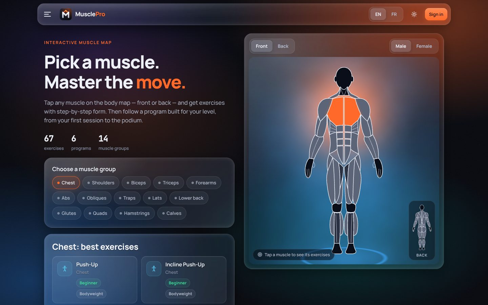
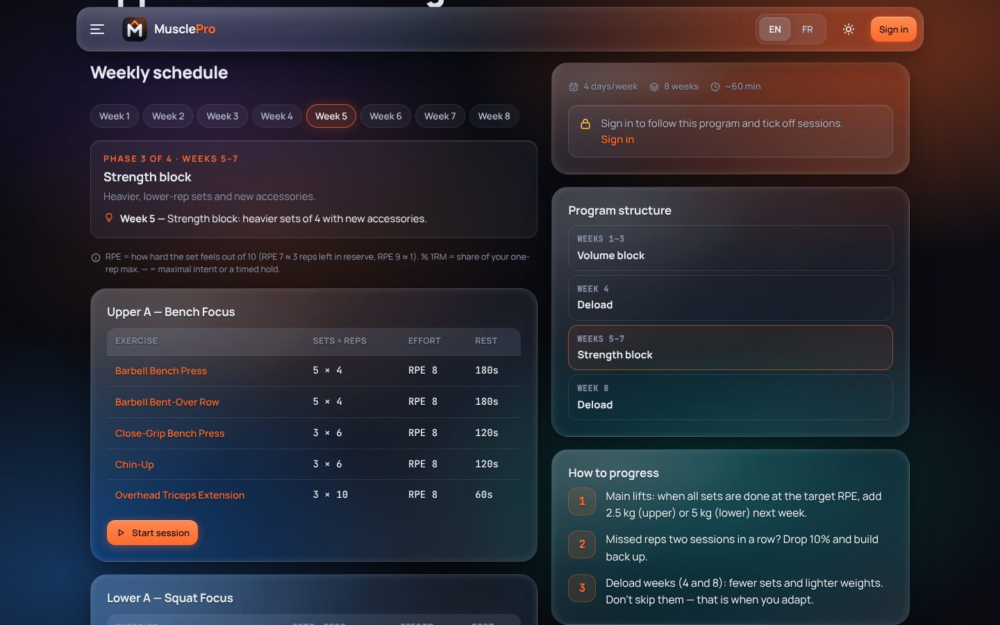
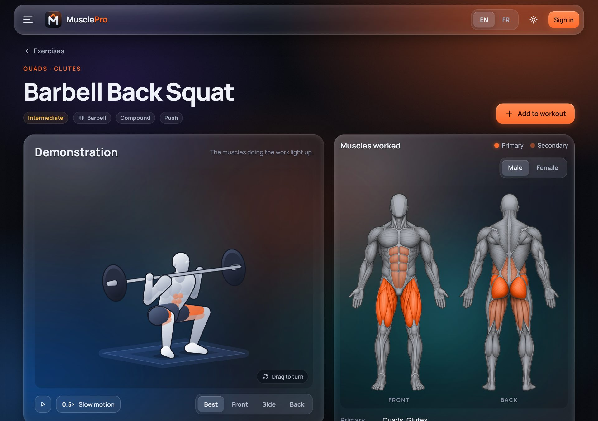
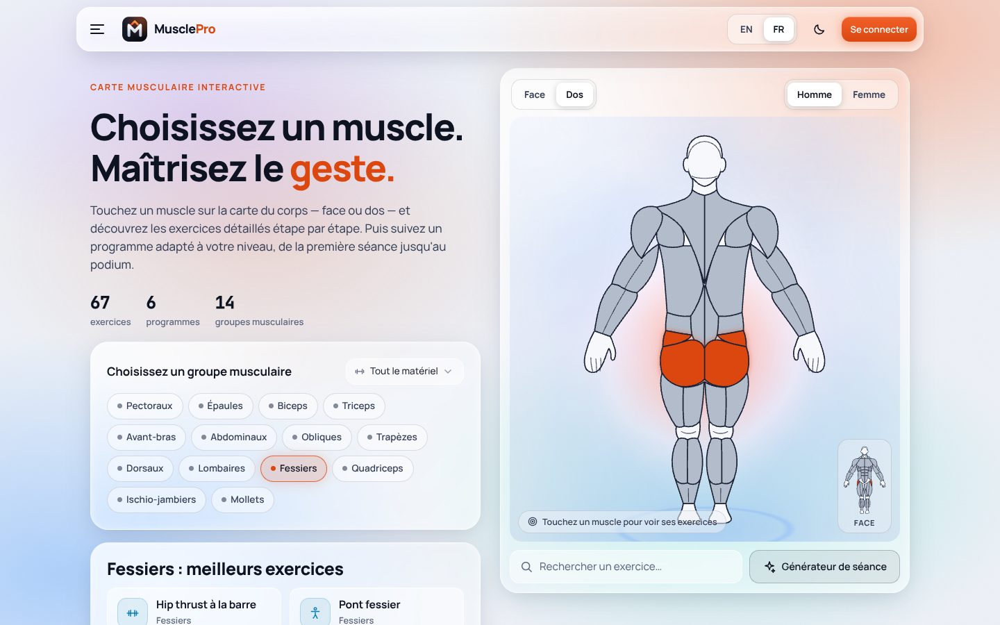
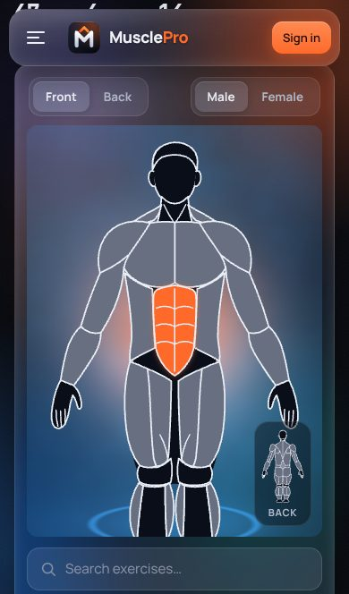

<p align="center">
  
</p>

<h1 align="center">MusclePro</h1>

<p align="center">
  <b>Pick a muscle. Master the move.</b><br />
  Interactive muscle map · 155 exercises with animated demonstrations and step-by-step form · programs from beginner to pro athlete · workout tracker<br />
  <sub>English &amp; Français · Liquid Glass UI · runs on Render's free plan with Firebase</sub><br />
  <a href="VISION.md"><b>Product vision →</b></a><br />
  <sub>Developed by <b>Khaled Bel Hedi</b> &amp; <b>Coach Khalil Haded</b></sub>
</p>

<p align="center">
  
</p>

| Program, week by week | Animated demonstration | Light theme · Français | Mobile |
| --- | --- | --- | --- |
|  |  |  |  |

---

## Features

**Train**
- **Muscle map**:
  - Professional écorché illustrations (male & female, front & back, dark & light artwork) with 14 tappable muscle groups (mouse, touch or keyboard); the highlight colour blends into the illustration's shading, and a thumbnail flips the body. A **Three.js + GLSL** light field glows behind the figure and travels to the muscle you pick.
  - Next to the body: an equipment filter for the suggested exercises, a quick exercise search and a shortcut to the workout generator. Muscles light up by role: primary, secondary, or how much you trained them this week.
- **Exercise library**: 155 exercises — strength, power and conditioning, plus 33 mobility and stretching drills and rehab-friendly work — each with numbered steps and a coach tip in EN/FR. Filters for muscle, equipment, level, type and search (accent-insensitive: “squat bulgare” works). Stretches show a suggested dose.
- **Animated demonstration of every exercise**: an athlete performs each of the 155 movements in a loop, with the working muscles lit up. Play / pause, slow motion, four camera angles, or drag to turn the athlete. The animation is computed in the browser by a small movement engine (no video files): it adds about 28 kB to the app, works offline, follows the theme, and waits for you to press play if your device asks for reduced motion. Also available under each exercise while you log a workout.
- **Periodized programs for every level**: Foundation Full Body, Home Bodyweight Starter, Upper/Lower Strength, Push·Pull·Legs (6 days, heavy A + volume B), Athlete Power & Speed, Peak Strength Block. Each one is written week by week like a coach would: **phases** that change the exercise variations, a different **sets × reps × effort** every week (RPE, or % of 1RM for strength and power lifts), **deload/taper weeks**, a coach note per week and completion tracking. Programs are generated and validated by `backend/scripts/build_programs.py`.
- **Workout generator**: goal × level × time × equipment × target muscles → a 2-drill warm-up matched to the session, then a balanced session ordered like a coach would (power first, compounds, isolation, core last). Stretches are never used as working sets.

**Track**
- **Live workout logger**: per-set weight with **per-set kg/lbs**, reps, done check, automatic rest timer, autosaved draft (survives reloads).
- **Progress**: sessions, week streak, total volume, 8-week volume chart, estimated 1RM records (Epley), “muscles trained this week” heat map on the body, **CSV export**.
- **Favorites** on any exercise.
- **Accessible**: WCAG 2.2 AA audit with no axe violations, a keyboard-operable muscle map, and correct contrast in both themes ([accessibility statement](docs/ACCESSIBILITY.md)).
- **Installable, works offline**: add MusclePro to your home screen; the exercise library, programs and workout logger keep working without signal (gym basement), and workouts finished offline are saved on the device and synced automatically when you're back online, keeping their real finish time.

**Accounts**
- Email + password sign-up/sign-in, profile (level, goal, unit, body model, language), password change (signs out other devices), sign out everywhere, self-service account deletion.
- **User management** for admins: search users, change role (athlete / coach / admin), suspend access, delete — with last-admin protection.

**Design**
- **Liquid Glass** surfaces (five-layer glass stack, one consistent light source, cursor spotlight, a single travelling light beam), dark & light themes, hamburger drawer with focus trap, `prefers-reduced-motion` respected everywhere.
- Original logo and hand-drawn SVG icon set; Manrope + JetBrains Mono, self-hosted.

## Stack

| Layer | Tech |
| --- | --- |
| Front-end | **Vite**, **TypeScript** (no framework), anatomy illustrations + SVG masks, **Three.js** + **GLSL** light-field shader, CSS design tokens |
| Back-end | **Flask** 3 (REST API + serves the built front-end), Gunicorn |
| Database | **Firebase Realtime Database** via `firebase-admin` (server-side only) |
| Auth | scrypt password hashes, signed JWT in an `HttpOnly` `SameSite=Lax` cookie |
| Hosting | **Render** free web service (Docker), Blueprint in `render.yaml` |

```
Browser ──HTTPS──▶ Render web service (Docker)
                    └─ Gunicorn ─ Flask
                         ├─ /api/*      JSON API (auth, catalog, workouts, admin)
                         └─ /*          Vite build (SPA fallback to index.html)
                                         │
                         firebase-admin ─┴─▶ Firebase Realtime Database
```

The exercise and program catalog ships with the code (`backend/app/data/*.json`) so it is versioned and costs no database reads; users, workouts, favorites and enrollments live in Firebase.

## Run locally

Requirements: Node 20+ and Python 3.11+.

```bash
# 1. API (terminal 1) — uses a local JSON file when Firebase is not configured
cd backend
python -m venv .venv && source .venv/bin/activate      # Windows: .venv\Scripts\activate
pip install -r requirements-dev.txt
export SECRET_KEY=dev-secret-key-change-me-dev-secret-key
export ADMIN_EMAIL=admin@example.com ADMIN_PASSWORD=Admin12345   # optional first admin
flask --app wsgi run --port 5000

# 2. Front-end (terminal 2) — http://localhost:5173, /api is proxied to :5000
cd frontend
npm install
npm run dev
```

To test the production build the way Render runs it: `cd frontend && npm run build`, then open http://localhost:5000 — Flask serves `frontend/dist`.

Tests and type checks:

```bash
cd backend && python -m pytest -q        # 27 API tests
cd frontend && npm run build             # tsc --noEmit + vite build
```

## Firebase setup (once)

1. In the [Firebase console](https://console.firebase.google.com/) create a project → **Build → Realtime Database → Create database** (pick a region, start in *locked mode*).
2. **Rules** tab → paste [`database.rules.json`](database.rules.json) (deny all client access — only the server's admin SDK reads and writes).
3. Copy the database URL, e.g. `https://musclepro-default-rtdb.europe-west1.firebasedatabase.app`.
4. **Project settings → Service accounts → Generate new private key**. Keep the downloaded JSON secret — never commit it (`.gitignore` already blocks `*firebase-adminsdk*.json`).

## Deploy on Render (free plan)

1. Push this repository to GitHub.
2. Render dashboard → **New + → Blueprint** → select the repo. `render.yaml` creates one free Docker web service and a random `SECRET_KEY`.
3. Fill in the prompted environment variables:

| Variable | Value |
| --- | --- |
| `FIREBASE_DATABASE_URL` | the URL from step 3 above |
| `FIREBASE_SERVICE_ACCOUNT` | the service-account JSON — paste it raw, or base64 (`base64 -w0 key.json`) |
| `ADMIN_EMAIL` / `ADMIN_PASSWORD` | your first admin account (created on boot if missing) |

Alternatively upload the key as a Render **Secret File** named `firebase-service-account.json` (read from `/etc/secrets/`) and leave `FIREBASE_SERVICE_ACCOUNT` empty.

4. Deploy. `/api/health` reports `"storage": "firebase", "persistent": true` when the database is connected (the admin page shows it too).

Free-plan notes:
- The service sleeps after ~15 min idle and needs up to a minute to wake. Returning visitors don't wait for it: the installed app opens from its cache after 3.5 s, keeps them signed in, and shows "Waking up the server…" until it answers. A first-time visitor still waits for the wake-up.
- Without Firebase, data lives in memory and is lost on every restart. The app then runs in **demo mode** (`"persistent": false`) and says so on the sign-in and register pages. Fine for a demo, not for real users.
- Keep `WEB_CONCURRENCY` at 1 unless Firebase is configured.

## Configuration

| Variable | Default | Purpose |
| --- | --- | --- |
| `APP_ENV` | `development` | `production` enforces `SECRET_KEY` and secure cookies |
| `SECRET_KEY` | random per process (dev) | signs session tokens — required in production |
| `SESSION_DAYS` | `7` | session lifetime |
| `FIREBASE_DATABASE_URL` | – | Realtime Database URL |
| `FIREBASE_SERVICE_ACCOUNT` | – | service-account JSON, base64 JSON, or file path |
| `FIREBASE_CREDENTIALS_FILE` | `/etc/secrets/firebase-service-account.json` | file fallback |
| `LOCAL_DB_FILE` | `backend/instance/dev-db.json` | local store when Firebase is off |
| `ADMIN_EMAIL`, `ADMIN_PASSWORD` | – | bootstrap admin |
| `AUTH_RATE_LIMIT`, `AUTH_RATE_WINDOW` | `10`, `300` | sign-in/sign-up attempts per IP per window (s) |
| `WEB_CONCURRENCY` | `1` | Gunicorn workers |

## Authors

Developed by **Khaled Bel Hedi** & **Coach Khalil Haded**.

## Anatomy assets & credits

| Asset | Source | Licence |
| --- | --- | --- |
| 2D body illustrations + muscle masks (`frontend/public/anatomy`, `src/data/muscle-masks.json`) | [js-rich-body-highlighter](https://github.com/crmapache/js-rich-body-highlighter) | MIT — `public/anatomy/LICENSE.txt` |

## Security

- Passwords hashed with **scrypt**; sign-in answers are identical (and equally slow) for unknown emails.
- Session JWT in an **HttpOnly, SameSite=Lax, Secure** (production) cookie; tokens carry a version that is bumped on password change, “sign out everywhere” and suspension, instantly revoking old sessions.
- **CSRF**: every state-changing `/api` call must send `X-Requested-With: MusclePro` — browsers can't add that header cross-site without CORS, which the API never grants.
- Strict **Content-Security-Policy** (`script-src 'self'`, no inline scripts), `frame-ancestors 'none'`, `nosniff`, HSTS in production.
- Rate limiting on sign-in/sign-up, server-side validation of every field, CSV export guarded against formula injection, open-redirect-safe `?next=` handling, Firebase rules deny direct client access.

## How the demonstrations work

`frontend/src/motion/` holds a small movement engine written for this app:

- **`rig.ts`** — a 3D skeleton in metres. A pose says where the hips are, how the trunk leans and where the hands and feet must be; elbows and knees are solved by inverse kinematics, so hands stay on the bar and feet stay on the floor through the whole movement.
- **`moves.ts`** — movement patterns with parameters (`squat`, `hangHinge`, `pushup`, `pullup`, `curl`, `walk`…). One pattern serves many exercises: the back squat, the goblet squat and the wall sit share the same code.
- **`demos.ts`** — one entry per exercise id: which pattern, which tempo (lower first, lift first, hold, or continuous loop) and the best viewing angle. A backend test fails if an exercise has no demonstration.
- **`render.ts`** — draws the athlete on a 2D canvas in the style of the muscle map: grey anatomical body, working muscles in the accent colour, equipment, floor shadow.
- **`player.ts`** — the player: timeline, controls, drag to rotate, pause when off screen, lower resolution on slow devices.

The demonstrations are schematic: they show the path of the movement and the position of the body, not a filmed athlete. They were checked frame by frame (hands and feet reach their supports, nothing goes through the floor), and a qualified coach should still review them before they are used to teach.

## Project structure

```
backend/
  app/__init__.py        app factory, security headers, SPA serving
  app/store.py           Firebase / in-memory store behind one API
  app/security.py        hashing, JWT cookie, CSRF, rate limit
  app/catalog.py         catalog loader + workout generator
  app/routes/            auth, me, catalog, workouts, admin
  app/data/              exercises.json, programs.json (EN/FR, generated)
  scripts/build_programs.py  periodized programs: edit, run, validated output
  tests/                 pytest suite
frontend/
  src/ui/anatomy.ts      2D muscle map (illustrations + traced masks)
  src/ui/bodyViewer.ts   muscle map viewer component
  src/three/             AuraBackdrop + GLSL light-field shader
  src/motion/            movement engine: rig + IK, renderer, movement patterns,
                         one demonstration per exercise, player
  public/anatomy/        body illustrations (MIT)
  scripts/               extract-muscle-masks.py
  src/views/             one module per page (code-split)
  src/ui/                shell + hamburger drawer, glass helpers, icons
  src/i18n/              en.ts, fr.ts
  src/styles/            tokens, glass, components, layout, views
Dockerfile · render.yaml · database.rules.json
```

## API overview

| Method & path | Auth | Description |
| --- | --- | --- |
| `POST /api/auth/register` · `login` · `logout`, `GET /api/auth/me` | – | account session |
| `PATCH /api/me`, `POST /api/me/password`, `POST /api/me/logout-all`, `DELETE /api/me` | user | profile & security |
| `GET/PUT/DELETE /api/me/favorites[/<id>]` | user | favorites |
| `GET /api/me/programs`, `POST/DELETE /api/me/programs/<id>` | user | program enrollment |
| `GET /api/exercises[?muscle&equipment&difficulty&q]`, `GET /api/exercises/<id>` | – | exercise catalog |
| `GET /api/programs`, `GET /api/programs/<id>` | – | programs |
| `POST /api/generate` | – | workout generator |
| `POST/GET /api/workouts`, `DELETE /api/workouts/<id>`, `GET /api/workouts/stats`, `GET /api/workouts/export.csv` | user | workout log |
| `GET /api/admin/users`, `GET /api/admin/stats`, `PATCH/DELETE /api/admin/users/<id>` | admin | user management |

---

### En français

MusclePro est une application d'entraînement : carte musculaire interactive (illustrations anatomiques professionnelles), face/dos, homme/femme, 155 exercices détaillés étape par étape (dont 33 de mobilité et d’étirement), chacun avec une démonstration animée (lecture, ralenti, angle de vue au choix), programmes périodisés semaine par semaine (phases, séries × répétitions × effort, semaines de décharge) du débutant à l'athlète pro, générateur de séances et suivi des performances (kg/lb par série, records, export CSV). Interface « Liquid Glass » en mode sombre/clair, menu hamburger, comptes utilisateurs et gestion des utilisateurs pour les administrateurs, entièrement bilingue anglais/français. Déploiement gratuit sur Render avec Firebase Realtime Database : suivez les sections *Firebase setup* et *Deploy on Render* ci-dessus.

> Health disclaimer: MusclePro provides general training information, not medical advice. Check with a health professional before starting a new program.
