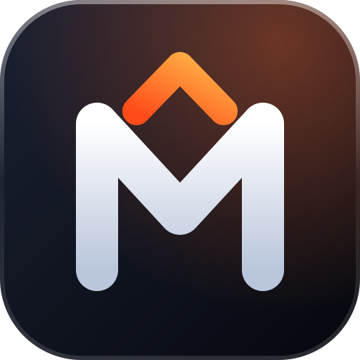

  

# MusclePro — Product Vision

_By Khaled Bel Hedi & Coach Khalil Haded_

> **Pick a muscle. Master the move.**
> One training companion that takes anyone from their first rep to the podium —
> starting from the body itself.

---

## 1. The idea in one paragraph

Most people who want to get stronger don't know *what* to train, *how* to do
it safely, or *what to do next week*. MusclePro answers all three, starting from
the most intuitive interface there is: the human body. Tap a muscle on a
professional anatomy map, get the right exercises with
step-by-step form, follow a program built for your level, and watch your body
light up as you train it. The same app serves a beginner doing push-ups at home
and a competitive athlete running a power block — in English and in French.

## 2. The problem we solve

| Who | What goes wrong today |
| --- | --- |
| **Beginners** | Overwhelmed by choice, unsure of form, quit within weeks because nothing tells them what to do next. |
| **Intermediate gym-goers** | Train the same few muscles, stall, and have no simple way to see balance or progress. |
| **Pro and competitive athletes** | Need structured, periodized power and strength work, precise logging (kg *and* lbs), and records — usually spread across spreadsheets and several apps. |
| **French-speaking athletes** | Most quality training tools are English-only or poorly translated. |

Existing muscle-map apps prove the demand, but many are cluttered with ads in the
middle of a workout, stop at "here is an exercise" without a plan, or treat
anatomy as a flat sticker rather than a living picture of your training.

## 3. Who it's for

- **Leïla, 27 — the beginner at home.** No equipment, 30 minutes, three times a
  week. Needs confidence and clear form cues. *Starts with:* Home Bodyweight
  Starter, the muscle map, coach tips.
- **Karim, 34 — the regular gym-goer.** Has trained for two years, plateaued.
  *Needs:* a real program (Upper/Lower, Push·Pull·Legs), progression rules,
  and proof that it's working.
- **Inès, 22 — the competitive athlete.** Plays a field sport at regional level.
  *Needs:* power and speed work in the right order, heavy strength blocks,
  estimated 1RM tracking, per-set units for mixed equipment.
- **Coaches (next).** Want to hand programs to athletes and see their logs.

## 4. Product principles

1. **Anatomy first.** The body is the home screen. Every exercise, program and
   statistic connects back to the muscles it trains, on a clear, professional
   anatomy illustration.
2. **Form before load.** Every exercise ships with numbered steps and a coach
   tip. We never push volume over technique.
3. **One app, first rep to podium.** Levels from beginner to pro athlete live
   side by side; users grow inside MusclePro instead of outgrowing it.
4. **Bilingual by design.** English and French are first-class, including
   exercise content, units and number formats — not an afterthought.
5. **Calm, premium, focused.** Liquid Glass design, no ads in the training flow,
   no dark patterns. A workout screen is for training.
6. **Trust and privacy.** Strong security by default, data export (CSV) and
   one-tap account deletion. We never sell personal or training data.
7. **Free to start, light to run.** Runs on free hosting tiers; heavy assets
   load only when asked for.

## 5. Where we are today (v1)

Shipped and running:

- **Muscle map** — professional anatomy illustrations (male/female,
  front/back, dark/light) mapped to 14 training groups.
- **155 exercises** with step-by-step form and coach tips, in EN/FR, including
  33 mobility and stretching drills and rehab-friendly work.
- **An animated demonstration for every exercise** — computed by a movement
  engine in the browser (no video), with the working muscles highlighted,
  slow motion and a camera you can turn.
- **6 programs** from beginner to pro: Foundation Full Body, Home Bodyweight
  Starter, Upper/Lower Strength, Push·Pull·Legs, Athlete Power & Speed, Peak
  Strength Block — periodized week by week: phases, weekly
  sets × reps × effort (RPE or % 1RM) and deload weeks.
- **Workout generator** — goal × level × time × equipment × muscles.
- **Workout logger** — per-set kg/lbs, rest timer, autosaved drafts.
- **Progress** — streaks, weekly volume, estimated 1RM records, weekly muscle
  heat map on the body, CSV export.
- **Accounts and admin** — secure sign-in, profiles, user management with roles
  (athlete, coach, admin).
- **Stack** — Vite + TypeScript + Three.js/GLSL front-end, Flask API, Firebase
  Realtime Database, one Docker service on Render.

## 6. Where we're going

### Now — make v1 excellent (next 3 months)

- **Go live** on Render with Firebase, monitoring and backups.
- ~~**Exercise media**~~ — **shipped**: an animated demonstration for each of
  the 155 exercises, generated by a movement engine rather than filmed, with
  a male and a female athlete. Next: review of every demonstration by a
  coach.
- ~~**150+ exercises**~~ — **shipped**: 155 exercises including 33 mobility and
  stretching drills and rehab-friendly work; generated sessions open with a
  matched warm-up.
- ~~**Installable app (PWA)**~~ — **shipped**: home-screen install, offline
  library, programs and logging; workouts sync when back online.
- ~~**Accessibility pass**~~ — **shipped**: WCAG 2.2 AA audit with no axe
  violations, keyboard-operable muscle map, reflow at 320 px
  ([statement](docs/ACCESSIBILITY.md)). Next: testing with real screen readers.

### Next — make it smart (3–9 months)

- ~~**Smart progression**~~ — **shipped**: each session suggests the load and
  reps for every exercise from what was actually logged (double progression,
  missed reps, % of 1RM, deloads, returns after a break), and explains why.
  Next: let athletes log RPE so the suggestions can use it.
- ~~**Recovery map**~~ — **shipped**: the body map shows which muscles are
  fresh, recovering or tired from recent training, and the generator leaves
  tired muscles out. Next: tune the model with coaches and let athletes
  correct it ("my legs feel fine").
- ~~**Coach mode**~~ — **shipped**: athletes join a coach with an invite code
  (and can leave at any time); the coach follows their sessions, records and
  recovery, assigns a program with a note and leaves feedback on workouts.
  Next: programs written by the coach, and a weekly summary per athlete.
- ~~**Custom programs**~~ — **shipped**: users and coaches write their own
  plans in a program editor or customize a copy of any program, share them by
  link, and coaches assign them to athletes. Next: plans that change from
  week to week (phases), like the built-in ones.
- **More languages** — Arabic and Spanish next, with right-to-left support.

### Later — the performance platform (9–18 months)

- **Athlete testing** — jump, sprint, and strength tests with benchmarks by
  sport and level.
- **Health integrations** — Apple Health / Google Fit for body weight, heart
  rate and activity.
- **Teams and clubs** — squads, shared plans and a team dashboard.
- **Coach marketplace** — verified coaches publish programs; MusclePro takes a
  fair share.

## 7. What we will not do

- **No medical claims.** MusclePro gives general training guidance, not
  diagnosis or rehabilitation prescriptions.
- **No ads inside workouts** and no selling of personal or training data.
- **No copied content.** Our anatomy assets are properly licensed (MIT and
  CC BY-SA, credited in `THIRD_PARTY_NOTICES.md`); exercises and programs are
  written by us.
- **No feature bloat.** If a feature doesn't help someone train better this
  week, it waits.

## 8. How we'll measure success

| Goal | Signal | Target (first year) |
| --- | --- | --- |
| People start | First workout logged within 24 h of sign-up | 50 % of new accounts |
| People stay | Active in week 4 after sign-up | 35 % |
| Plans work | Program weeks completed vs started | 60 % |
| People progress | Users who move up a level (beginner → intermediate…) | 20 % within 6 months |
| Athletes trust it | Pro-level users logging 3+ sessions a week | 70 % of pro accounts |
| It feels great | Satisfaction score (NPS) | ≥ 50 |
| It stays fast | Mobile page load (LCP), muscle map interactive | < 2.5 s |

These are targets to aim for, not current results.

## 9. Business model (hypothesis to validate)

- **Free** — muscle map, exercise library, programs, logging and
  progress. The core must stay free.
- **MusclePro Plus** — smart progression, recovery map, unlimited custom
  programs, advanced analytics.
- **Coach & Team** — per-athlete pricing for coaches and clubs.
- Start on free hosting; move to paid tiers only when usage justifies it.

## 10. Technical direction

- Keep the **single-origin architecture** (SPA served by the API) — simple,
  secure and cheap to run.
- Firebase Realtime Database for user data now; revisit (Firestore or
  PostgreSQL) when we need richer queries for coaches and teams.
- **Anatomy as a platform** — one muscle taxonomy shared by the body map,
  exercises, programs and analytics, so every new feature lights up the body
  for free.
- Performance budgets are features: lazy-load heavy assets, respect
  reduced-motion and low-power devices.
- Security stays non-negotiable: strict CSP, hashed passwords, revocable
  sessions, rate limits, and a security scan in CI before launch.

## 11. Risks and open questions

- **Demonstration accuracy** — the animated demonstrations are generated, not
  filmed. They scale to every exercise at no production cost, but each one
  needs a coach's review, and filmed clips may still be worth adding for the
  most technical lifts.
- **Free-tier limits** — Render's free plan sleeps when idle; plan the move to
  a paid instance before public launch.
- **Licensing** — the anatomy illustrations are MIT-licensed: keep the
  licence file with them.

---

## Résumé en français

**MusclePro : choisissez un muscle, maîtrisez le geste.** Une application
d'entraînement qui part du corps humain — une carte musculaire
professionnelle — pour guider chacun, du débutant à
l'athlète de haut niveau : exercices détaillés étape par étape, programmes
périodisés semaine par semaine, générateur de séances et suivi des progrès, en français et
en anglais. Nos principes : l'anatomie d'abord, la technique avant la charge,
un design premium sans publicité pendant l'entraînement, et le respect de la
vie privée. Chaque exercice a sa démonstration animée, et chaque séance propose la charge et les répétitions à viser. La carte de récupération montre les muscles frais ou fatigués, et le générateur en tient compte. Le mode coach relie un coach à ses athlètes, avec leur accord, et chacun peut écrire et partager ses propres programmes. Prochaines étapes : mise en production, validation des démonstrations par un coach
et programmes à phases.
